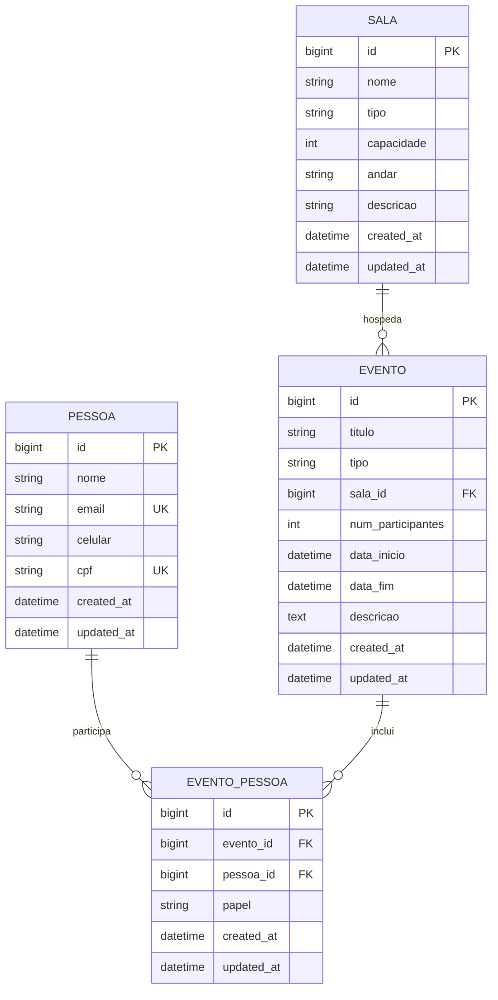

# Diagrama de Entidade e Relacionamento (ER)

Este diagrama descreve a estrutura do banco de dados do sistema de agendamento de eventos CEAD.

## Relacionamentos
1.  **Sala -> Evento**: Uma sala pode hospedar múltiplos eventos, mas cada evento ocorre em apenas uma sala (1:N).
2.  **Evento -> Pessoa (Pivô)**: Um evento possui várias pessoas vinculadas (como organizadores ou palestrante) e uma pessoa pode participar de vários eventos (N:M). O papel da pessoa no evento (organizador, palestrante, participante) é definido na tabela pivô `evento_pessoa`.
